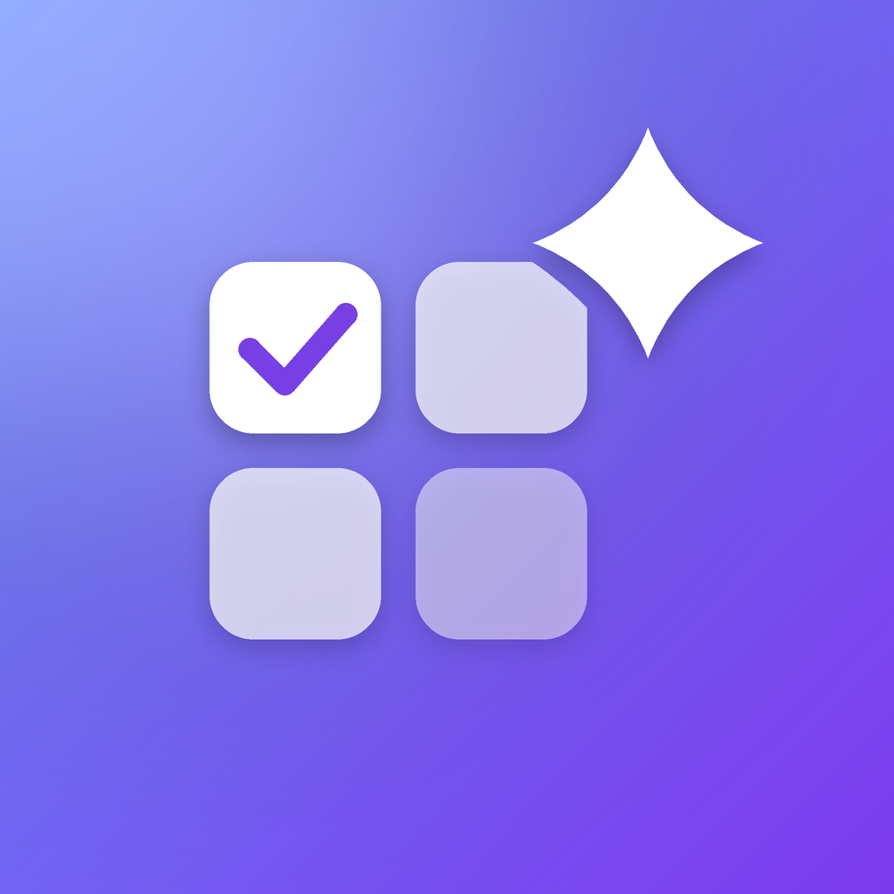

<p align="center">
  
</p>

# WorkspaceAssistant Lite

A task board with an **on-device AI agent**, built with Apple's
[Foundation Models](https://developer.apple.com/documentation/foundationmodels) framework.
Type what you want in plain English and watch the agent change the board for you: tiles move, columns fill,
the layout morphs, and every action it takes appears in the chat.

> **This is the teaching version:** 10 files and about 940 lines, small enough to read in one sitting.
> For the complete app with undo, persistence, nine tools, tests and full accessibility, see
> **[WorkspaceAssistant-Full](https://github.com/firasqais/WorkspaceAssistant-Full)**.

It was written for the course *Architecting Apple Intelligence: On-Device AI & Agentic Workflows*, and comes with a
step-by-step tutorial that builds it from an empty project.

---

## Requirements

| | Minimum | Notes |
|---|---|---|
| **Mac** | Apple silicon | |
| **Xcode** | 26 or later | Tested with Xcode 27 |
| **iOS** | 26.0 or later | iPhone |
| **Apple Intelligence** | Optional | Needed for the real agent: a supported iPhone (15 Pro or later), or a simulator on a Mac with Apple Intelligence turned on |
| **Apple developer account** | Free or paid | Needed to run on a physical iPhone |

No API keys, network calls or third-party packages. Without Apple Intelligence, a **simulated agent** takes over: a
keyword-based stand-in, clearly labelled in the chat, that understands short requests like the suggestions.

## Getting started

1. Clone the repository and open `WorkspaceAssistant.xcodeproj`.
2. Select the **WorkspaceAssistant** target › **Signing & Capabilities**, and choose **your own Team**.
   If the bundle identifier is taken, change `au.edu.uts.WorkspaceAssistant` to something unique.
3. Choose an iPhone and press **⌘R**.
4. Tap **Ask the Agent** and try a suggestion, or type your own request.

You can work alongside the agent: **+** adds a task, **tap** a tile to complete or reopen it, and
**press and hold** a tile to prioritise, complete or delete it. **Reset Board** in the top-right menu starts again.
The board isn't saved, so every launch starts from the same six sample tasks.

---

## How it works

```
 "Prioritise the memory leak and show my tasks as a board"
                     │
                     ▼
     TaskAgent ── session.respond(to:) ──► on-device model
                                               │  decides to call tools
                     ┌─────────────────────────┤
                     ▼                         ▼
          PrioritizeTaskTool            SwitchLayoutTool
                     │                         │
                     └──────────┬──────────────┘
                                ▼
     Workspace (the ONLY place state changes, for taps AND tools)
                                │  returns a truthful sentence to the model
                                ▼
                SwiftUI redraws the board, with animation
```

Three ideas carry the whole app:

- **Tools are thin adapters.** Each tool has a name and description (when to use it), `@Generable` arguments (what
  the model must fill in) and a `call` that runs Swift code. The four tools add, complete and prioritise tasks, and
  switch the layout.
- **One place for every change.** The user's taps and the agent's tools call the same `Workspace` methods; only
  `by: .user` or `by: .agent` differs. The agent can never do anything the user couldn't.
- **Truthful results.** Each command returns a sentence saying what really happened, including "nothing changed" or
  "no single task matches". That sentence is what the model reads, so it can't claim success that didn't happen.

### Read the code in this order

| # | File | One-line idea |
|---|------|---------------|
| 1 | `Model/TaskItem.swift` | The data. `@Generable` enums mean the model can only pick valid values |
| 2 | `Model/Workspace.swift` | Commands shared by taps and tools |
| 3 | `Agent/Tools.swift` | The four tools |
| 4 | `Agent/TaskAgent.swift` | One `LanguageModelSession` with tools and instructions; the agentic loop runs inside `respond(to:)` |
| 5 | `Views/BoardView.swift` | Only reads `Workspace`, so every change animates in by itself |
| 6 | `Views/AgentPanel.swift` | The chat; tool calls appear live as chips |
| 7 | `Views/ContentView.swift` | The board, with the agent in a half-height sheet so the board stays visible |
| 8 | `Views/NewTaskSheet.swift` | The user's "add task" form, calling the same command as the tool |
| 9 | `WorkspaceAssistantApp.swift` | Creates the workspace and the agent |
| – | `Agent/SimulatedAgent.swift` | The stand-in for devices without Apple Intelligence. Not AI |

### Try these

1. *Add a high-priority task to review pull requests*
2. *Prioritise the memory leak and show my tasks as a board* (two tools from one request)
3. *I finished the unit tests and the CI pipeline* (tasks slide into Done)
4. *Now make the onboarding redesign important too* (the session remembers the conversation)
5. *Mark the database migration as done* (no such task: the agent says so instead of pretending)
6. Press and hold a tile and delete it yourself: your tap and the agent's tool run the same command, and only the
   agent's changes appear as chips.

---

## Step-by-step tutorial

The `Tutorial` folder builds this app from an empty project: **6 tutorials, 38 steps**, with code that updates as you
scroll, app previews, quizzes and a project download, in the style of Apple's SwiftUI tutorials.

| How | Use it |
|---|---|
| `Tutorial/Workspace Assistant Tutorial.html` | Double-click to open in any browser. Works offline and prints to PDF |
| `Tutorial/Preview Tutorial.command` | Double-click to serve the DocC tutorial from your Mac |
| `Tutorial/Export Tutorial.command` | Double-click to make a `.doccarchive` that opens in Xcode |
| `Tutorial/WorkspaceAssistant.docc` | The DocC source |
| [`Swift-Code-Guide.md`](Swift-Code-Guide.md) | Every Swift keyword and attribute the tutorials use (`@Observable`, `private(set)`, `@MainActor`, `@Generable`…), explained with the app's own code. Also a page in the tutorial |

| Chapter | Tutorial | Builds |
|---------|----------|--------|
| The Board | Modelling the Board | `TaskItem`, `Workspace` |
| The Board | Drawing the Board | `BoardView`, `ContentView`, the app |
| The Agent | Giving the Agent Tools | `Tools.swift` |
| The Agent | Talking to the Agent | `TaskAgent`, `AgentPanel`, the agent sheet |
| Working Together | Working Alongside the Agent | New-task form, tile menu, simulated agent |
| Working Together | Your First Tool | Lab 1: `DeprioritizeTaskTool` |

The last step of every file matches the code in this repository; the final tutorial adds the Lab 1 solution.

<details>
<summary>Replacing the tutorial's mockup images with real screenshots</summary>

The previews are drawn mockups. To use real screenshots, take them in the simulator (**⌘S**, iPhone 17, light mode)
and save them over these files in `Tutorial/WorkspaceAssistant.docc/Resources/Images`:

| File | What to capture |
|------|-----------------|
| `wa-preview-grid.png`, `wa-preview-contentview.png` | The board in grid view after launch |
| `wa-preview-layouts.png` | Grid, list and board side by side (memory leak prioritised, audit done) |
| `wa-preview-agent-panel.png` | Agent sheet pulled up to full height, before any request |
| `wa-preview-agent-sheet.png` | Board with the agent sheet at half height |
| `wa-preview-agent-run.png` | After "Prioritise the memory leak and show my tasks as a board" |
| `wa-preview-newtask.png` | The New Task form with "Review Pull Requests" typed |
| `wa-preview-contentview-plus.png` | The board after adding it as high priority |
| `wa-preview-context-menu.png` | Press and hold "Fix Memory Leak in Feed" |
| `wa-preview-deprioritise.png` | The same menu once Lab 1 is done |
| `wa-preview-simulated.png` | Agent sheet with Apple Intelligence off |

Keep the `wa-preview-tile-*`, `wa-preview-chat-rows` and `wa-diagram-*` images as they are. Regenerate the HTML
tutorial afterwards so it picks up the new images.
</details>

---

## Labs

### Lab 1 · Your first tool: `DeprioritizeTaskTool`

1. In `Workspace.swift`, add the command next to `prioritize`, and the agent's way in next to `prioritizeTask`:

```swift
@discardableResult
func deprioritize(_ id: TaskItem.ID, by: ChangedBy) -> String {
    guard let index = index(of: id) else { return "That task no longer exists." }
    guard tasks[index].isHighPriority else { return "“\(tasks[index].title)” isn’t high priority. Nothing changed." }
    tasks[index].isHighPriority = false
    tasks[index].revision += 1
    return record("star.slash.fill", "Deprioritised “\(tasks[index].title)”", by: by)
}

func deprioritizeTask(_ query: String) -> String {
    guard let id = findTask(query) else { return problem(query) }
    return deprioritize(id, by: .agent)
}
```

2. In `Tools.swift`, add the tool:

```swift
struct DeprioritizeTaskTool: Tool {
    let name = "deprioritizeTask"
    let description = "Removes high priority from an existing task."
    let workspace: Workspace

    @Generable
    struct Arguments {
        @Guide(description: "The user's words for the task, e.g. 'memory leak'")
        var task: String
    }

    func call(arguments: Arguments) async throws -> String {
        await workspace.deprioritizeTask(arguments.task)
    }
}
```

3. Register it in `TaskAgent.makeSession(for:)`: add `DeprioritizeTaskTool(workspace: workspace),` to `tools`.
4. Bonus: add a "Deprioritise" button to the tile's press-and-hold menu in `BoardView.swift`, calling `deprioritize(task.id, by: .user)`.
5. Try: *"The memory leak can wait."* Then try a vague description and see whether the model still picks your tool.
   Discuss: the **description** is the API contract the model reads.

### Lab 2 · Streaming the reply

In `TaskAgent.swift`:

```swift
private(set) var streamingText = ""          // 1. new property

// 2. in send(_:), replace the `let response = try await session.respond(to: prompt)` line and the one after it:
streamingText = ""
for try await snapshot in session.streamResponse(to: prompt) {
    streamingText = snapshot.content
}
messages.append(Message(role: .agent, text: streamingText, actions: liveActions))
```

In `AgentPanel.swift`, pass it to `WorkingRow` and show it under the chips:
`if !text.isEmpty { Label(text, systemImage: "sparkles") }`.

### Lab 3 · Sessions

- Tap **New Chat**, then say *"undo that"*: the model has forgotten. Sessions are memory.
- Move `makeSession` into `send(_:)` so every prompt gets a new session. What breaks?
- Dynamic instructions: add a user profile to the instructions, e.g.
  *"The user is Rina, an iOS lead. Treat anything about release or App Store as high priority."*
  Then ask: *"Add a task to submit the build to the App Store."*

### Lab 4 · Build a new tool, pick one

| Tool | What it teaches |
|------|-----------------|
| `ListTasksTool` (returns open tasks, changes nothing) | Read-only tools let the model look before it acts |
| `RenameTaskTool` | Two arguments the model has to fill |
| `ClearDoneTasksTool` | One call, many changes |
| `SetCategoryTool` (argument: `TaskCategory`) | Reusing a `@Generable` enum |
| `SetAccentColorTool` | The AI changes the app's look, not only its data (Day 3 preview) |

Every tool follows the same three steps as Lab 1: command in `Workspace`, tool in `Tools.swift`, register in `makeSession`.
`delete(_:by:)` already exists for the user's menu, so a `DeleteTaskTool` only needs the "agent's way in" plus the tool.

New tools need the real model: the simulated agent only knows the four built-in ones.

---

## Lite and Full compared

| | **Lite** (this repository) | **[Full](https://github.com/firasqais/WorkspaceAssistant-Full)** |
|---|---|---|
| Size | 10 files, ~940 lines | 120+ files, ~6,600 lines |
| Architecture | One `@Observable` `Workspace` class | MVVM: `WorkspaceCommand`, `WorkspaceStore`, view models |
| Agent tools | 4 | 9 (adds find, delete, tile colour, accent colour, checklist steps) |
| Board layouts | Grid, List, Board | Grid, List, Focus, Board |
| Reply | Arrives in one piece (streaming is Lab 2) | Streamed word by word |
| Saving | None; resets on launch | SwiftData, plus preferences |
| Undo | No | Yes, for the user's and the agent's changes |
| Screens | One board | Tasks, Collections, Search, Settings |
| Tests | None | Swift Testing unit tests, XCTest UI tests, accessibility audit |
| Best for | Learning and live demos | Seeing how a production app is put together |

## Troubleshooting

| What you see | What to do |
|---|---|
| The chat says *Simulated agent* | Apple Intelligence isn't available. Turn it on in *Settings › Apple Intelligence & Siri*, use a supported device, or wait for the model to download |
| The agent says it couldn't find a task | Use words from the task's title. When a request matches several tasks, the agent asks which one you mean |
| *This conversation got too long* | The on-device context window is small. The app starts a fresh session; tap **New Chat** and try again |
| *Signing requires a development team* | Choose your Team in *Signing & Capabilities* |
| Lab tools don't respond in the simulated mode | New tools need the real model; the simulated agent only knows the four built-in ones |

## Privacy

Everything runs on the device. Requests, replies and tasks never leave the iPhone.
